# Aphelion Dev Journal

## Week 1

Intending to continue working on Souls-like, but likely rebuilding it.

Leaning heavily on this tutorial series that I found on Monday.  It's a very long series for an Elden Ring implementation so there are a lot of features that I don't need and can skip.  Likewise it is a multi-player implementation so I need to work around that as well.  Interesting learning a little bit about Unity NetCode though.

A key reason I am referring to this tutorial instead of just extending the original Terminus code is having a better implementation of the character controller, especially in regards to animation & using root animation to drive some movement but not all.

I'll be using the Synty Dark Fantasy,  Locomotion animation & Combat Animation asset packs.

They are missing a couple of things like "using a lever", "drink potion", "open door" animations but should be easy to implement.

The "dodge back" animation needs it's root motion adjusted as it isn't much of a dodge, seems like less than a meter and could stand to be double that.  I had a brief look at editing it in Unity and it worked but would slide back to the original unedited point at the end.  Obviously missing something.

Have completed up to the stamina implementation.  Mine varies a little based on what I learned from Terminus.

Another deviation from the tutorial is that I am using UIToolkit instead of Unity UI.  This is mostly because I am very familiar with web development and it is more intuitive to me.

---

### Pitch thoughts

- 3rd person action RPG
- focus on deep combat that is "tough but fair"
    - blocking
    - stance breaking
    - poise
    - attacks vary per weapon

- non-intrusive narrative
    - item descriptions
    - NPC dialog
    - environmental storytelling

- regions are heavily interconnected with unlockable shortcuts

- combined character XP/currency
    - dropped on death

- bonfire/lantern spawn points
    - rest at:
        - refills flasks
        - resets enemies in region

- 3 "play phases"
    - exploring new area
        - expect to die
        - learning area, enemies etc
        - trying to find new bonfires & shortcuts
    - boss attempts
    - area runs
        - practicing
        - trying new weapons/tactics
        - farming XP
        - area leading up to boss (especially runbacks) should be aiming to teach you the things you need for the boss & give opportunity to practice those things

- upgrading
    - character stats
    - weapons
    - items
    - armour

- potion/flask
    - fixed number refilled at bonfire
    - can be upgraded
        - number of uses
        - amount healed

---

- [x] inputs
- [x] assets
- [x] character prefab
- [x] world scene
- [x] main scene
- [x] camera
- [x] movement
- [x] dodge

## Week 2 (Mon Jul 27 - Sun Aug 2)

- [x] sprint
- [x] stamina
- ~~[ ] saving (4)~~
- [x] jump & fall (2)

Okay on a team of one.  this means I have to focus my scope.

Hopefully can get a contractor for animation.

I want to get combat & AI in.  Keep AI simple based on Terminus code.  Stretch for "plan AI".

Level design needs to be established early I think.

Thoughts: I want to make the 3 phases of play obvious to players.  Not sure how, maybe NPC dialog overtime based on progress/actions ?

- movement
- combat
- AI
- environment
- interactables?  ladders, doors, bonfire, elevators

Health & damage is done.  I like the system of "Character Effects" scriptable objects for damage as a means of bundling up damage numbers, visual effects,  audio, animation etc.

Part way into the weapons code

## Week 3 (Mon Aug 3 - Sun Aug 9)

- [x] character effects (2)
- [x] health (1)
- [x] damage (1)
- [x] you died (1)

story/theme ideas:
- it's just capitalism:
    - nothing specific storywise
    - each region is an abstraction of a different problem in capitalism
    - each major boss is representative of a particular stereotype
- queer time / trans grief
    - the world has shattered into different shards of time that do not align with each other anymore
    - the villain has caused this to happen by travelling back in time to change events
    - "firelink shrine/hunters dream" area could be a tiny pocket of stable time of the original timeline
    - you are an individual who has the unique ability to travel safely between the shards
    - travelling through each shard, defeating bosses that control each in order to make it to the final boss & defeat them & restore the timeline
    - reveal:
        - the villain is you ... well one version of you
        - unable to deal with the sense of loss of the childhood they were denied the villain figures out how to time travel & change it
        - doesn't work properly & messes things up so they keep trying, which makes the world increasingly broken
        - very The Butterfly Effect
        - each of the bosses are very different versions of the same character as well but all from very different timelines
    - maybe the characters who help you in the "stable time pocket" actually know the truth and they are concealing it from you.
## Week 4 (Mon Aug 10 - Sun Aug 16)

Contractors will not be available.

- 10th: collision improvements
- 10th: foundations for weapons & items, inventory
- 12th: weapon action foundations
- 12th: item action foundations
- 15th: audio system basics, roll audio, hit audio, impact FX, target lockon, skeleton character

- [x] weapon items (2)
- [x] hit detection (1)
- [x] weapon item based actions (3)
- [x] directional damage animation (1)

## Week 5 (Mon Aug 17 - Sun Aug 23)

- [x] lock on (3)

- 19th: lock-on system done.  no ui though.
 - 20th: outline shader for lock target?  https://www.youtube.com/watch?v=Bm6Bmcjd1Mw
outline shader is not great with synty models - would have to do weirdness with normal smoothing, but baking into vertex colours & shenanigans in the shader.  a black outline is really nice though.  Will do the "unsmoothed" version now and look into smoothing later.  I only have to do it to the enemy models so probably only 4 or 5.

Organising tasks for sprints.  I think I'm going to organise into 2 week sprints.  will make it easier for me to progress with smaller units of work

still lots of combat stuff that can be implemented, but I'm going to start the AI work in sprint 3 and get the basics done so the combat loop is complete

 - 23rd: I started on the AI stuff and I've started refactoring some of the movement mechanics, mainly falling, back into base character manager class instead of the player manager.  It's fiddly and maybe I should just duplicate those things in the ai character manager to start with & refactor into the base class as opportunity arises.

# Sprint 3

- AI characters
    - [x] state machine
    - [x] idle
    - [x] pursue
    - [x] combat stance
    - [x] attack action

## Week 6 (Mon Aug 24 - Sun Aug 30)

- [x] fix AI movement

Concept: when player dies a pool spreads out under them, like a pool of blood but it doesn't have to be blood, which the body then sinks into, and then they climb back out of a corresponding pool of liquid at the spawn point.  Was initially imagining a black liquid like oil, or perhaps a well for the spawn point that they climb out of The Ring style. The oil makes me think of a character who has been corrupted by pollution ala The Toxic Avenger or even Godzilla.

Considering the idea of multiple characters like in Borderlands although I could only implement one in this timeframe, I could demonstrate it with placeholder UI for character selection.  Having each character have their unique spins on different core mechanics based on how the events in the backstory of the game has affected them is interesting.  Maybe different "bonfires"?  Each area of the game having to have different "bonfires" for each character in different places would mean that each would experience that region differently.  That would require a lot of level design work, or at least a strategy to accommodate the idea in design.

In co-op play that would mean each player would have different spawn points.

Going back to the pollution idea: each character gets their powers as a result of different things that have destroyed the environment.

Each character has their own starting area & unique path through the game.  Each character would also travel through the other starting areas, but at different times in their playthough and with different things happening.  That would make the different spawn points more reasonable in terms of design.

The starting area for each would reflect their individual circumstances & effect on them.

What core other mechanics could change?  Different vendors, different XP currency?

Aside from specific character abilities that each would have.

I don't like the idea of having them fulfil different gameplay roles ... they should each be customisable to do whatever you want.  So if you like the tanky role you can play each ever you want not just one.  Ideally also have multiple gender & race options each each as well.

What would be the destruction factors?
1. carbon pollution - oil
2. radioactive waste
3. plastics?
4. mono-culture ecology, species extinction
5. chemical/fertilizer run-off
6.

These would be driving forces for character & environment design

Also damage types / resistances

Or more systemic things / ideologies that can be destructive:
- Capitalism
- Fascism
- Individualism
- Racism
- Sexism

All the isms

## Week 7 (Mon Aug  31 - Sun Sep 6)

- Been spinning my wheels on this
- the AI character in-place rotation animations is annoying as hell so I'm back burnering that
- Reference: Quaternions explained visually in 381 seconds https://www.youtube.com/watch?v=MpyGVvC-13s
- got AI in-place rotation working without animation.  This can be good enough for now.
- continuing AI combat stance & attacks
- started putting more ideas down in diagrams

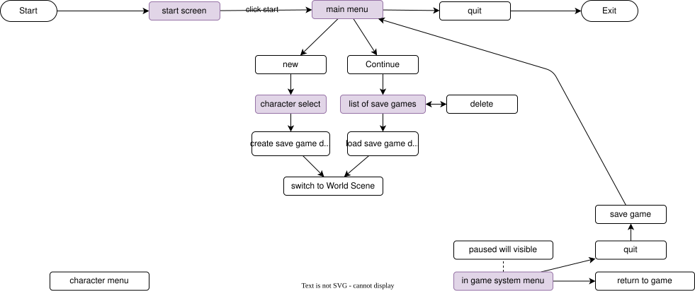
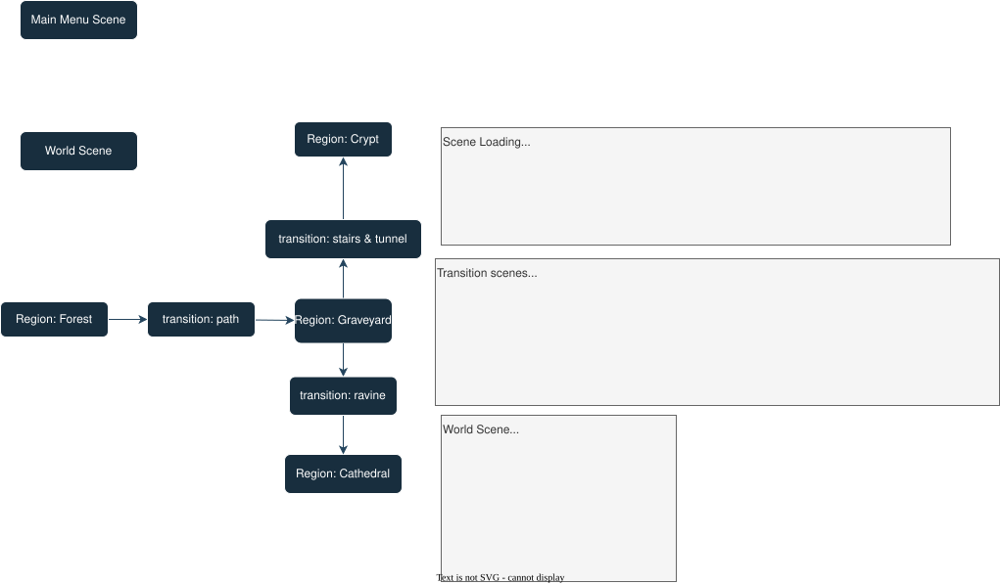
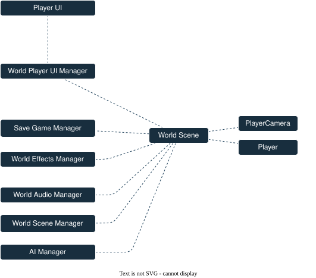

# Sprint 4

- [x] AI damage dealing

- combat sound effects
    - [x] weapon whoosh 
    - [x] player take damage grunt
    - [x] skeleton idle/chase/attack sound
- [x] weapon trail effect
 
- [x] saving

- [ ] bonfire/well respawn on death
- [x] decide on respawn point model / name / concept

- [ ] AI management/spawning
- [ ] clean menu/world/region scenes & management
- [ ] game save/load
- [ ] basic UI for start screen, new game, load game etc

- [ ] input queuing
- [ ] weapon switching & UI
- [ ] blocking
- [ ] enemy healthbars
- [ ] decide on a set of weapons to include
- [ ] two-handed weapons
- [ ] interact-able objects
- [ ] poise
- [ ] weapon combos
- [ ] weapon-based animation controllers (animation overrides)

## Week 8 (Mon Sep  7 - Sun Sep 13)

- finalising initial AI attacks, damage dealing

- planning
    - add an effect of a spreading pool of liquid under the dead player body
    - when respawn is implemented, pool of similarly coloured liquid that you crawl out of.  maybe a well of some sort.

### Sat Sept 12

 - added weapon trails

#### unqiue value proposition
re discussion with Alex: What core "souls" mechanic should I tweak?

Elements:
- combat
    - stamina
    - lock on
    - blocking
    - poise
    - ripost
- currency / leveling
- respawn
- flask healing

Stamina does feels like the obvious one.

##### momentum

 - how to replicate the importance of maintaining momentum against an enemy?
 - power meter that builds up for each attack that lands
 - depletes when you get hit
 - power is required to use special abilities

I like this one.

##### healing

 - no stamina
 - special abilities require "resolve" to be spent
 - resolve gained via attacks
 - healing is an ability that consumes resolve

##### healing 2

 - after certain attacks land there is a "gears of war" style time meter that appears
 - if you time a button press with it you heal back an amount 

##### Pheonix concept
 - combining health & stamina
 - you have much more, but many actions consume it
 - it also slowly ticks down over time
   - this negates slow exploration play so maybe not
 - attacking/defeating enemies increases it
   - similar to Mortal Shell 2 resolve
 - incentivizes aggression & speed
 - maybe healing locations, special fires that you consume

 - I think this might detract from the exploration, 
 - players would be incentivised to only think in terms
 - of paths, not the environment & hence any environmental
 - story telling would have to be very free of nuance or
 - detail

##### time markers
 - when the marker is activated complete world state is saved
 - dying resets you back to a the most recently activated marker 
   and resets world state to the marker
 - quick travel resets world state to the marker
 - you are travelling in time
 - you can't travel forward, only back
 - some things, major bosses perhaps don't reset because they exist out of time like you do

### Sun Sept 13 

 - basic weapon whoosh implemented

## Week 9 (Mon Sep  14 - Sun Sep 20)

### Wed Sept 16

#### Momentum concept

- Something I want to try and capture is the importance of maintaining momentum in a fight.

---
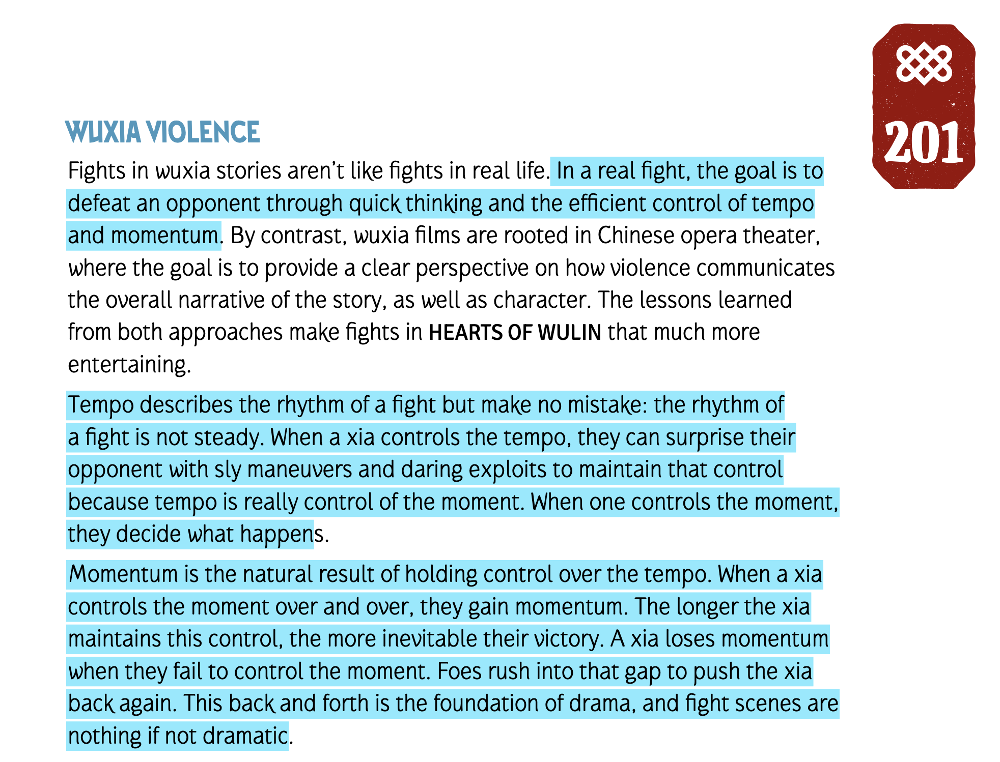
Hearts of Wulin P202

---

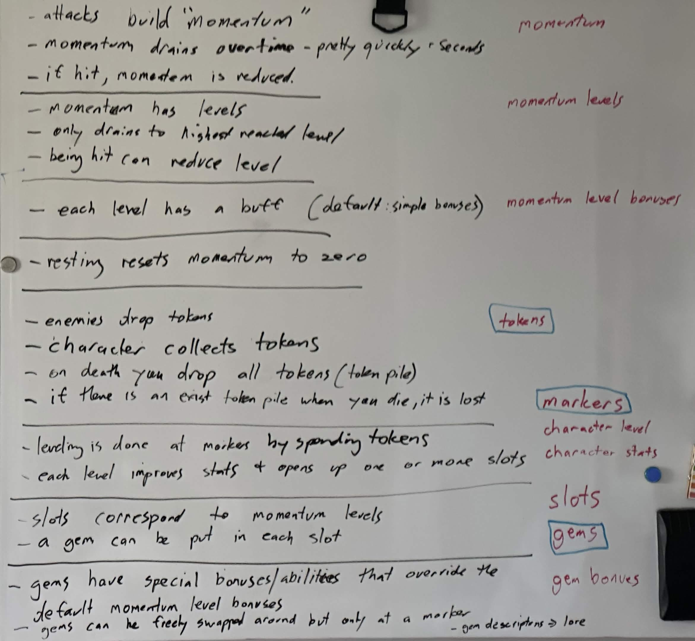
 
 - Keeping the pressure on your opponent
 - And how you can lose that
 - Also creates the interesting situation where the run back to a boss becomes important because you can be  building that up on the way to come into the fight already powered up
 - Vs avoiding all the enemies & starting the boss fight at zero momentum & having to build it all up against the boss
 - You could make a boss harder just be reducing your ability to easily build momentum before him
 - A boss that spawns adds, is giving you a way to build momentum as well as more threats
 - Maybe the enemies in the  region before the boss could be balanced in terms of how much momentum you gain from them (ie how many hits to kill) so an region effectively has character level that once you pass that you are killing them too easily & not building up enough momentum to be maxed out when you reach the boss
 - But maybe past that level your abilities would be much better anyway & not need you to max them out as much for that boss
 - I guess this replaces stamina
 - Instead of getting tired being a limiting factor, it’s more about being able to snowball into a greater threat
 - Thinking about if special abilities etc should consume momentum ...
 - However the benefit of using them is mostly to kill things faster, so using them actually reduces momentum gain
 - Like having to hit something 3 times gives you 3 times the momentum of one shotting it
 - And there is always room to build in special cases - maybe some do consume momentum, or health
 - Or don’t gain momentum when using them

---

 - Laura suggested "salts" as the something that character requires to keep functioning.  She was mostly thinking
    in terms of marine biology & how land animals essentially have to carry their own little internal sea around with them.
 - The idea being that the character is originally from the sea but has to exist on land ... hence needs salts.
 - Not sure if I would want to pursue that in this game but I do like "salts" as the "souls" currency.
 - It is something you need to live and also fits as currency due to the association with payment of Roman soldiers (not 100% true though)
 
---

### Wed Sept 15 

 - worked on hacking together some UI from the Synty assets

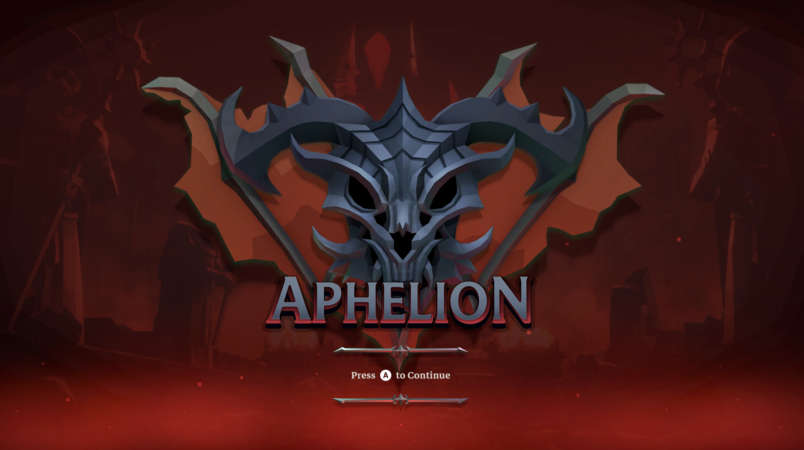

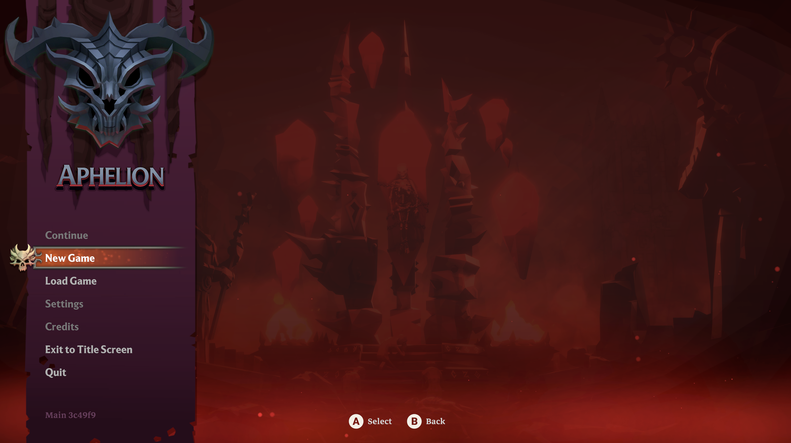

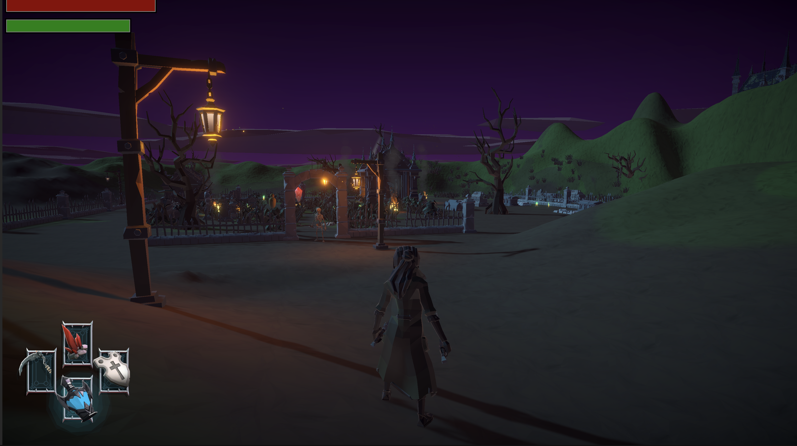

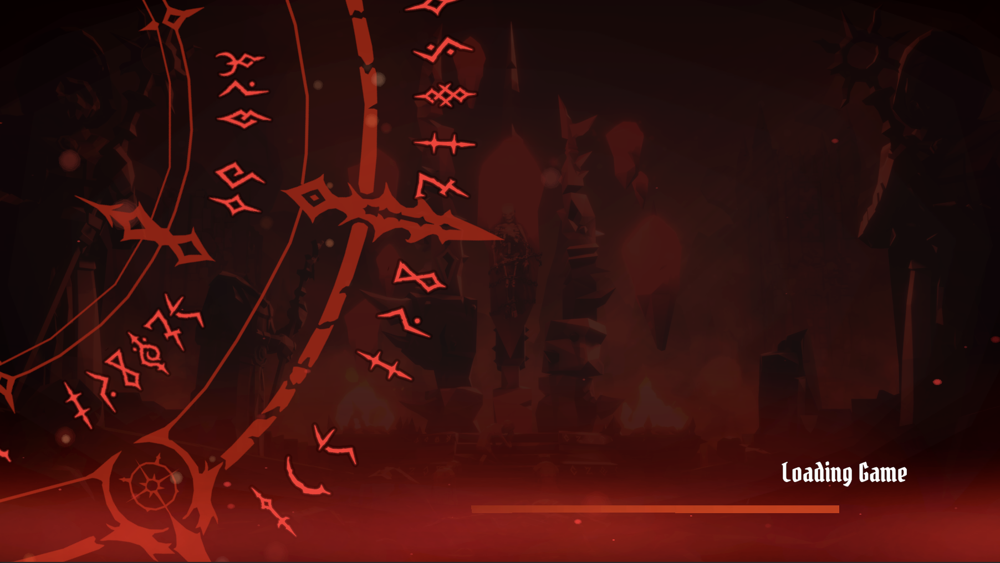

---

Giving some more throughts to mechanics, this is more of a future thing but ...

Some of the Synty assets gave me some thoughts, especially the metallic demon skulls.  I like the Ossiarch 
Bonereapers concept from Age of Sigmar, where they superficially might look like skeletons, they they are actually 
custom combined souls inserted into custom crafted skeletons.  They didn't look like that when they were alive, 
and their soul is made up of parts from multiple different souls, with the intention of creating perfect soldiers.  
So the part of their souls that has compassion and empathy, its just deleted.  Each individual is made up of the 
experiences of multiple soldiers merged together, with their own uniqueness mostly deleted.

Also the show Dollhouse played with this a bit with the idea of being able to overwrite one person's memories 
with that of another, with the original being backed up.

 - the "gems" contain skills & abilities of others but also their memories
 - when you slot a gem, you are overwriting part of your own memories

This could also be used to influence dialog or other options in the game.

Maybe if you have a certain gem slotted, specific secret walls are highlighted that would otherwise just look normal.

Or some dialog options are available that would not be otherwise.
There is also the cost that some other options could be unavailable because you don't have those memories anymore

Maybe the slots have default meanings, like empathy, childhood memories, time in the war, etc that once you slot 
something there they get lost.

The TTRPG Fate of Cthulhu plays with this too.  The corrupting influence of The Old Ones is represented by their 
technology which can be used to give you cool powers, but in doing so each one replaces one of your characters 
"concepts".  So you become more powerful, but at the cost of you becoming less connected with your human life & 
relationships.

So potentially interesting narrative idea, how much are you prepared to give up in pursuit of your goals?

Keeping the idea of being able to move gems around freely to let the player experiment, you could still have whatever
the empty slot represented in their mind be lost as soon as a gem is put there.  If you remove the gem, the slot is just 
blank.  Maybe an NPC you can find later in the game provides the facility to create backups of those unused slots.

Interesting to make decisions about what to sacrifice, and then later on find that maybe you didn't need to sacrifice those things. 

Future thoughts.

### Wed Sept 16

 - having to think more about game flow to ensure everything works

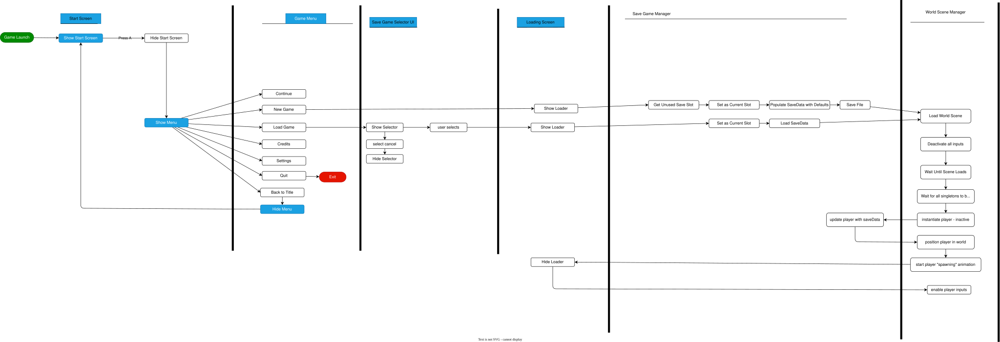

#### scene environment settings:

 - skybox material: carcosansky
 - sun source: None
 - realtime shadow color: #21315B
 - environment lighting
    - source: gradient
    - sky color: #596B8E
    - equator color: #1F2029
    - ground color: #475A98
 - environemtn reflections:
    - source: skybox
    - resolution: 128
    - Compression: auto
    - intensity multiplier: 1
    - bounces: 1
 - other settings
    - fog 
        - color: #371637
        - mode: Linear
        - start: 0
        - end: 900
    - Halo texture: None
    - Halo strength: 0.205
    - flare fade speed: 3
    - flare strength: 1
    - spot cookie: Soft

---

Decided on this floating crystal for my spawn point markers.  I think by default they will have a duller non-emissive material & then glow once they have been activated.  Nice Dark Crystal vibe.

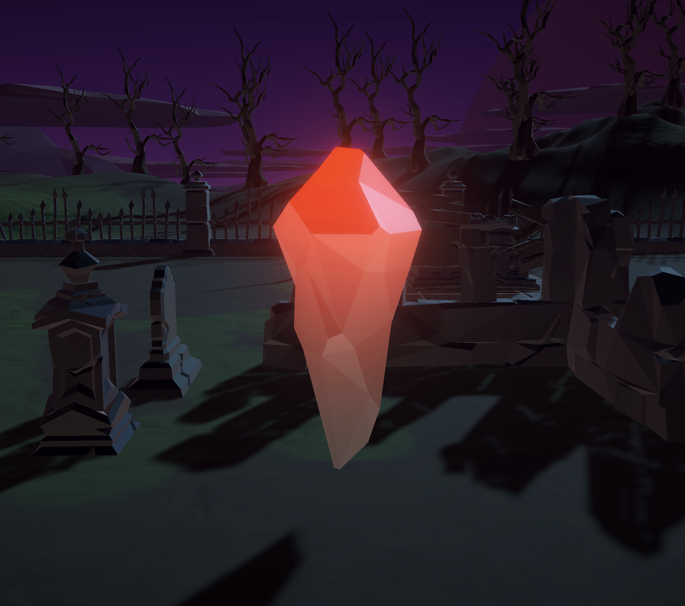

 - Save game loading/saving basics (de/serialization & filehandling) have been implemented.  
 - Character stats, active crystals, and last used crystal are saved.
 - right now only saving is wired up, with it happening when player enters proximity of a crystal

### Thu Sept 17

# Sprint 5

- [ ] item pick ups
- [ ] equipment UI
- [ ] stance breaking
- [ ] riposte
- [ ] backstab
- [ ] flasks

- [ ] runes
- [ ] level up
- [ ] revive & reclaim runes

- [ ] dual wielding/power stance
- [ ] breakable objects
- [ ] elevators
- [ ] doors
- [ ] ladders

## Week 10 (Mon Sep  21 - Sun Sep 27)

## Mid Trimester Break (Mon Sep  28 - Sun Oct 4)

### Thur Oct 1

Well I finally have the menus & scene loading sorted.  Didn't have a lot of time over the past couple of weeks to spend on this so Kind of abandoned everything else to get this done so 
 
 - [x] clean menu/world/region scenes & management
 - [x] basic UI for start screen, new game

 As implemented you can only start a new game and it only uses slot01 and overwrites it.  I think for demo simplifying down to a single save slot with  New Game & Continue.  New Game will have to prompt before overwriting if one already exists.  And continue is only an option if the save slot is already occupied.  Maybe with Load greyed out on the menu.

 #### backlog to consider

 - [ ] bonfire/well respawn on death
 - [ ] AI management/spawning
 - [ ] game save/load
 - [ ] input queuing
 - [ ] weapon switching & UI
 - [ ] blocking
 - [ ] enemy healthbars
 - [ ] decide on a set of weapons to include
 - [ ] two-handed weapons
 - [ ] interact-able objects
 - [ ] poise
 - [ ] weapon combos
 - [ ] weapon-based animation controllers (animation overrides)
 
 
I think interactables, because crystals need to be interactable to activate & rest at likewise doors, elevators, ladders.

So next up: 
 - interactables
 - activating crystals
 - resting at crystals ie (healing)
 - respawn on death
 - healing & HUD
 - AI management (ie resetting on player rest)
 - enemy healthbars
 - poise
 - input queuing
 - weapon UI switching

Then 
 - salt collection & recovery, even if no leveling implemented
 - doors (including locked on one side doors)
 - elevators at least
 - a couple of different enemies - at least a few different humanoid types and maybe wolves.  Maybe big brute guys
 - more weapons & attacks 
 - maybe pickables for new weapons

 somewhere in here I need to consider switching to momentum instead of stamina but we will see

# Sprint 6

- [ ] finalizing level designs
- [ ] 

## Week 11 (Mon Oct  5 - Sun Oct 11)

## Week 12 (Mon Oct  12 - Sun Oct 18)

# Cleanup
## Week 13 (Mon Oct  19 - Sun Oct 25)

